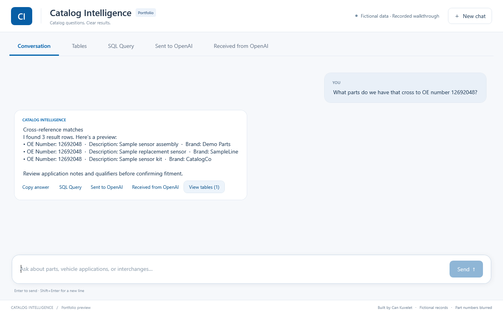
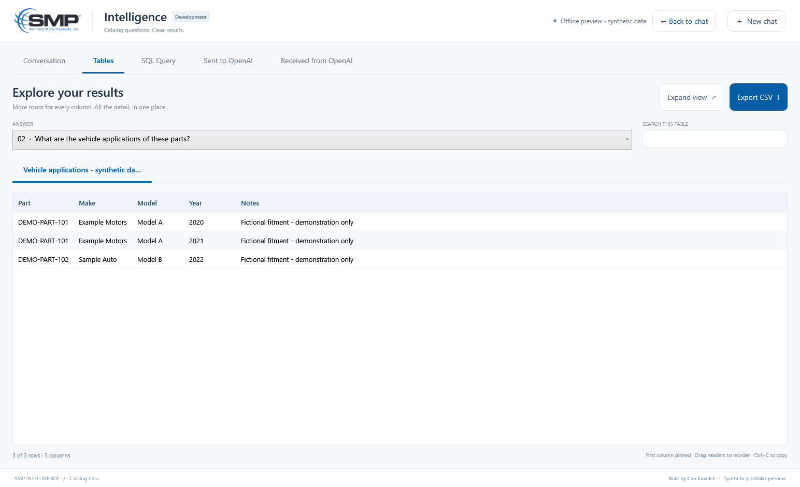

# SMP Intelligence

**Ask questions about automotive parts in everyday language**

SMP Intelligence is a Windows application that helps users find matching part numbers and explore which vehicles those parts fit, without writing database queries. It combines automotive catalog knowledge with AI to make information previously investigated through Microsoft Access, SQL Server, and Excel easier to explore.

**Status:** Working prototype developed for internal use and demonstrated to stakeholders. A pilot with employees is the next stage.

**Built with:** C# · .NET 8 · WPF · SQL Server · OpenAI API

## Try the runnable code sample

**[Open the live demo →](https://kuvelet.github.io/SMP-Intelligence/)** — no installation, sign-in or API key. Try a reference lookup, follow up about vehicles, or test a blocked SQL query.

The public sample lets you run parts lookups, follow up about vehicle fitment, inspect the SQL, and try queries the validator blocks. It includes C# source, a fictional catalog, and **105 automated test cases**.

The hosted version runs the same C# planning and validation source inside the browser using WebAssembly, with a browser-local SQLite database. Questions and results stay in that browser. Its question planner is explicitly offline; it is not a live AI service. [How the live demo is built](docs/live-demo.md)

To run the local server version yourself, install the [.NET 10 SDK](https://dotnet.microsoft.com/en-us/download/dotnet/10.0), then:

```sh
git clone https://github.com/Kuvelet/SMP-Intelligence.git
cd SMP-Intelligence
dotnet run --project sample/Smp.Sample.Web
```

Open **http://127.0.0.1:5080**. No company access, database installation or API key is required. The sample uses an explicitly labeled offline question planner and a real local SQLite database. The original prototype uses OpenAI and SQL Server.

**[Run instructions and two-minute tour](sample/README.md)** · **[Start with the query validator](sample/Smp.Sample.Core/SqlGuard.cs)** · **[Browse the tests](sample/Smp.Sample.Tests)** · **[CI results](https://github.com/Kuvelet/SMP-Intelligence/actions/workflows/sample-ci.yml)**

Run the tests with `dotnet test SmpSample.slnx`. [See what was extracted and what changed for the sample.](docs/sample-design.md)

## The original Windows prototype



*The actual application interface, shown with fictional sample data and prepared responses. These screenshots illustrate the workflow; they are not live AI results. The contact footer is adapted for the portfolio.*

## The problem

Answering a parts question can involve several related lookups: finding matching part numbers, identifying the vehicles they apply to, and checking model years and fitment notes. The existing workflow involved Microsoft Access, SQL Server, and Excel.

I built a conversational interface to bring those supported catalog lookups into one question-and-answer workflow. Users can start with a part reference and follow up about the matching parts.

## A typical workflow

1. Ask: “Which parts match reference number DEMO-OE-1001?”
2. Review the matching part numbers.
3. Follow up: “Which vehicles do these parts fit?”
4. Review the table of vehicle applications and any fitment notes.

The screenshots show this workflow using fictional parts and vehicles.



## My contribution

I initiated and developed the prototype, applying my automotive catalog knowledge throughout the project. My work covered:

- **The desktop experience:** asking questions, exploring tables, and following up on results.
- **The AI and database connection:** translating questions into database queries and checking those queries before execution.
- **Transparency:** letting users inspect the proposed query and the information exchanged with the AI model.
- **Application delivery:** building installation and update tools for the Windows environment.

I used AI coding assistance while defining requirements, directing iterations, and reviewing the application's behavior. I also demonstrated the prototype internally.

## How it works

The AI model proposes SQL, the instructions used to retrieve database records. The backend—the program that handles requests—checks whether those instructions follow the application's rules before running them.


The model receives catalog instructions, database structure, and the user's questions. SQL Server supplies the result records, which the application formats locally. Those result records are not sent back to the model in this implementation.

The prototype includes controls for:

- Restricting queries to supported read-only operations on the two catalog tables.
- Handling several requests at once while keeping each reply matched to its question.
- Limiting daily usage, query duration, and displayed results.
- Checking downloaded application files before opening an update.

Technical details, tradeoffs, and limitations are explained in the [architecture notes](docs/architecture.md).

## Testing

**Public sample:** run the 105 cases in this repository with `dotnet test SmpSample.slnx`. These include the 75 SQL validation cases below, plus checks of actual sample records, follow-ups, execution boundaries and HTTP responses. [Sample design and test scope](docs/sample-design.md)

**Original prototype:** the existing automated test suite completed successfully on November 16, 2026:

- **Passed 75 SQL validation test cases covering supported queries and prohibited operations.**
- Checked that simultaneous requests receive the correct replies and respect usage limits.
- Checked that temporary file-access problems do not corrupt saved information.
- Checked that recorded AI exchanges stay attached to the correct answer, including when a request fails.

These tests use prepared examples and simulated services. They check application behavior; evaluating whether the AI answers catalog questions correctly is a separate next step.

[Test results and evaluation plan](docs/validation.md)

## Next steps

The current prototype supports part cross-references and vehicle applications within a shared company network. The next steps are to compare its answers with known catalog results and run a limited employee pilot to measure usefulness and task completion.

A browser version with company sign-in is planned as a future development stage.

## About this case study

This repository includes the case study, original-interface screenshots with fictional records, and a runnable public source-code sample. The query validator is adapted from the prototype; the sample interface, offline planner and SQLite fixture are separately implemented for public review. The complete internal application and company data are not included.

Author: [Can Kuvelet](https://kuvelet.github.io/portfolio/)

